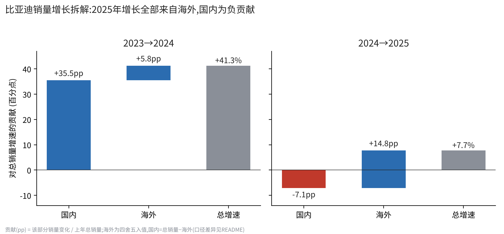
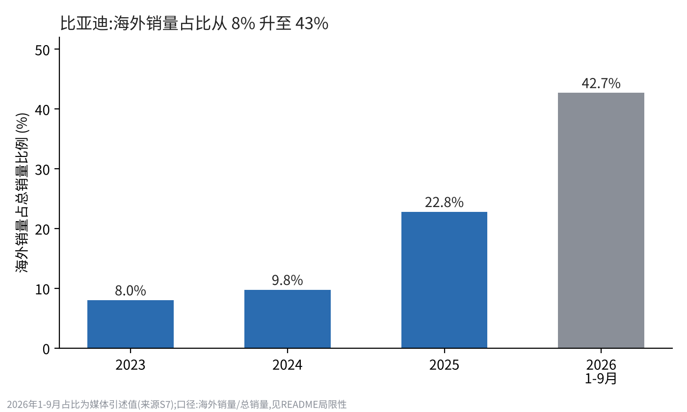

# 比亚迪出海增长拆解 · BYD Overseas Growth Decomposition

**一句话结论**:2025 年比亚迪总销量增长 7.7%,其中海外贡献 **+14.8 个百分点**,国内贡献 **−7.1 个百分点**——全部净增长来自海外。海外销量占比由 2023 年的 8.0% 升至 2025 年的 22.8%,2026 年 1–9 月为 42.7%。

*English summary: Using only public disclosures, this repo splits BYD's annual unit-sales growth into domestic vs. overseas contributions (in percentage points). In 2025, overseas added +14.8pp while domestic subtracted −7.1pp, giving +7.7% total growth.*




## 结果

| 区间 | 总增速 | 海外贡献(pp) | 国内贡献(pp) | 海外同比 | 国内同比 |
|---|---|---|---|---|---|
| 2023→2024 | +41.26% | +5.77 | +35.49 | +71.8% | +38.6% |
| 2024→2025 | +7.73% | +14.80 | −7.07 | +151.6% | −7.8% |

方法:`贡献(pp) = (该部分本期销量 − 上年同期) / 上年总销量 × 100`,海外与国内两项相加等于总增速(代码里有断言校验)。

## 复现
```bash
pip install -r requirements.txt
python analysis.py        # 生成 data/results.csv 与 charts/
```
也可直接打开 `notebook.ipynb`。

## 数据
- `data/annual.csv`:2023–2025 年度总销量与海外销量
- `data/snapshots.csv`:2025-12、2026-08、2026-09、2026 年 1–9 月等关键节点数据与 2025 年海外营收
- `data/sources.csv`:每个数字的来源链接(S1…S8)

仅使用公开披露的信息。**没有使用 Wind / Choice / iFinD 等付费终端的数据。**

## 局限性(请务必先读)
1. **口径不完全一致**:海外销量(多为"海外乘用车及皮卡")与总销量(新能源汽车合计,含商用车)不是同一口径,"国内 = 总销量 − 海外"是近似值。
2. **部分数字来自媒体转载**:2025 年总销量、2024 年总销量来自公司公告;2023–2025 年海外销量与 2026 年数据来自媒体转载公司披露,精确到万辆的数值为四舍五入。2023 年总销量与同比增速互相吻合,但我没有逐条核对其原始公告。
3. **一处不一致**:按本表计算 2025 年海外同比为 +151.6%,而一篇媒体报道称出口"同比大增 140%",二者可能是统计口径不同(出口 vs 海外销售),尚未核实,使用前请对照公司原始公告。
4. **2026 年 1–9 月只有占比,没有拆解**:缺少去年同期的精确海外和总销量,因此未做增长贡献计算;42.7% 为媒体引述值。
5. **销量不等于收入**:2025 年境外营业额 3,107 亿元,约占总营收 38.6%(来源 S8,媒体转载年报),与销量占比不是一回事。
6. **只做了比亚迪单家**:对标车企(吉利、奇瑞、长城等)的海外口径各家不同,没有硬凑对比。
7. 这是个人公开数据分析,不是对任何公司的咨询或投资建议。相关不等于因果,本项目不解释"为什么增长"。

## 下一步
- 补全月度数据,看海外占比的季节性与运力约束
- 用公司官方公告替换媒体转载来源
- 统一口径后加入对标车企
